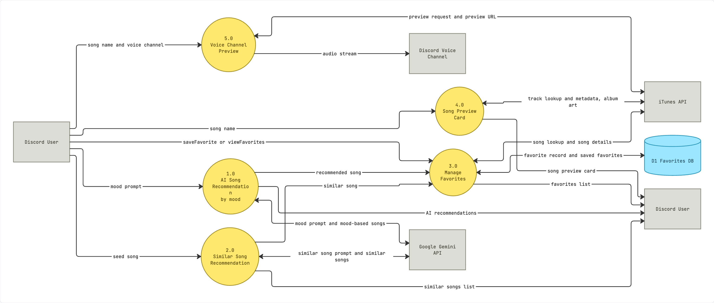
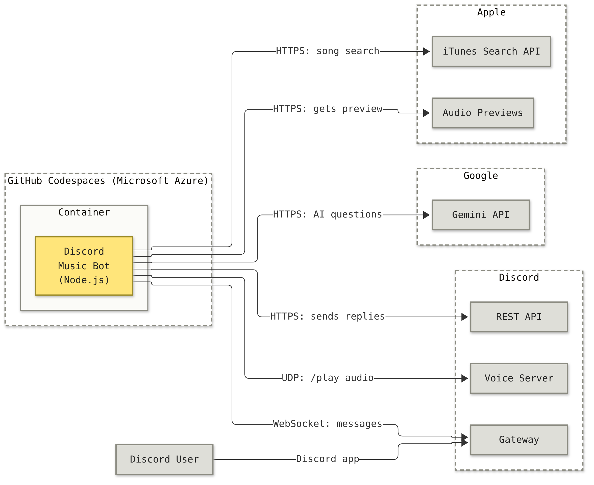

# Architecture

This document describes how data moves through our Discord music bot, using a System Context Diagram and Data Flow Diagram.

**Notation**

| Symbol | Meaning |
| --- | --- |
| Gray rectangle | External entity |
| Yellow circle | Process |
| Blue cylinder | Data store |
| Arrow | Data flow |

## System Context Diagram

The whole bot is shown as a single process, together with the external systems it talks to.

## Data Flow Diagram

### Processes

| ID | Process | Command | External service |
| --- | --- | --- | --- |
| 1.0 | AI Song Recommendation by mood | AI chat | Google Gemini API |
| 2.0 | Similar Song Recommendation | `/similar` | Google Gemini API |
| 3.0 | Manage Favorites | `/saveFavorite`, `/viewFavorites` | iTunes API, D1 Favorites DB |
| 4.0 | Song Preview Card | `/song` | iTunes API |
| 5.0 | Voice Channel Preview | `/play` | iTunes API |

## Network Diagram

This diagram shows where the bot runs and what it connects to over the network.

### How to read this diagram

- **Gray boxes** are services. **Dashed boxes** are separate networks owned by different companies.
- **Arrows** point from whoever starts the connection. All of the bot's connections start at the bot, so nothing on the internet connects into the bot.

### Connection types

| Type | Used for | How it works |
|------|----------|--------------|
| WebSocket | Receiving messages from Discord | One connection the bot opens at startup and keeps open, so Discord can push new messages anytime |
| HTTPS | Replies, song search, audio download, AI | The bot sends a request and waits for one response |
| UDP | Streaming `/play` audio | A fast live stream that does not wait to confirm every packet arrived |
