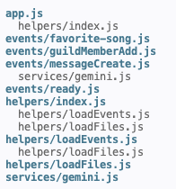
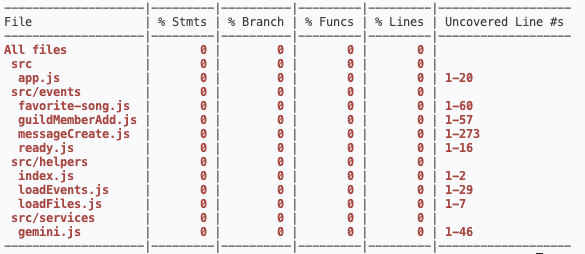

## 1. Technical Debt and Code Smells (Suna Karaman)

### Introduction
In this part, I analyzed our Discord bot to identify code smells and technical debt that could affect its performance, and maintainability. My goal was to find weaknesses in our existing code, understand why they could become problems, and suggest possible improvements. I used ESLint and static analysis to examine the code.

### Method

I ran ESLint with our existing configuration. Then, I added rules to check function length (maximum 80 lines) and nesting depth (maximum 3).

After that, I manually reviewed the code using static analysis to find duplicated code, missing error handling, and unnecessary code. I also used `grep` to check whether certain parts of the code were being used.

I performed the analysis on my `task-5-code-analysis` branch without running or changing the bot.

### Findings

**1. `messageCreate.js` — Long Function and Duplicated Code**

ESLint found that the `execute()` function has 300 lines, which exceeds my selected limit of 80. This function handles many commands, including `hello`, `ping`, `/song`, `/play`, `/similar`, and `/ai`. Having too many responsibilities in one function makes the code harder to read and maintain.
I also noticed that `/song` and `/play` use similar code to make requests to the iTunes API. This is duplicated code because both commands repeat the same process instead of using a shared function.

**2. `favorite-song.js` — Temporary Storage and Missing Error Handling**

I was already aware that favorite songs are stored using `const favorites = new Map()`. This was a temporary solution when I developed the feature. Since the data is stored in memory, users lose their favorites when the bot restarts. I knew this was something we would need to improve later.

I also noticed that `message.channel.messages.fetch(replyId)` does not have a `try/catch` block. If the original message is deleted or unavailable, the bot may fail without giving the user a clear explanation.

**3. `loadEvents.js` — Unnecessary Code**

I found that `client.events` is created and updated, but it does not appear to be used elsewhere. I checked this using `grep`, which showed only three references across our source files.

Since the bot already uses `client.on()` to register event handlers, the collection appears to be unnecessary.

**4. Other Files — No ESLint Warnings**

I also analyzed `guildMemberAdd.js`, `ready.js`, and `loadFiles.js`. ESLint did not report any problems using my selected function-length and nesting-depth rules. However, this does not mean these files are completely free of code smells.

### Recommendations

Based on my findings, I think we should separate the commands in `messageCreate.js` into smaller functions to make the code easier to read, test, and maintain. We could also create one shared function for the iTunes API requests instead of repeating similar code in `/song` and `/play`.

For `favorite-song.js`, I recommend using a JSON file or database to store favorite songs so users do not lose them when the bot restarts. We should also add `try/catch` to handle errors when fetching messages and give users a clear response if something goes wrong.

Finally, I recommend removing the unused `client.events` collection in `loadEvents.js` if we confirm it is not needed anywhere else. This could help keep our code simpler and avoid unnecessary complexity.

## 2. Cyclomatic Complexity (Suna Karaman)

### Introduction

In this part, I measured the cyclomatic complexity of our Discord bot to understand how complex the functions are. My goal was to identify functions with too many decision paths, understand how this could affect testing and maintenance, and find possible ways to reduce unnecessary complexity.

### Method

I used ESLint to measure the cyclomatic complexity of each JavaScript file in our Discord bot. First, I set the threshold to 10 to identify functions with high complexity. Then, I changed it to 0 so ESLint would show the complexity of every function, including simple ones.

I analyzed each file separately using the following command and changing the file path:

```bash
npx eslint src/events/messageCreate.js --no-config-lookup --rule 'complexity: ["warn", 0]'
```
I used `--no-config-lookup` to ignore the project's existing ESLint configuration and apply the same rule to every file. I performed the analysis on my `task-5-code-analysis` branch without running or changing the bot.

### Findings

### 1. messageCreate.js — High Complexity


ESLint reported that the execute() function has a cyclomatic complexity of 38, which is much higher than my selected threshold of 10. This is the most complex function in our bot. It handles several commands, including hello, ping, /song, /play, /similar, and /ai. Having multiple commands and conditions in one function increases the number of possible execution paths.

### 2. favorite-song.js — Moderate Complexity


The execute() function has a complexity of 12, which is slightly above my threshold of 10. This function handles both saving and viewing favorite songs. It also contains several conditions to check whether a song can be saved.

### 3. guildMemberAdd.js — Low Complexity


ESLint reported four functions with complexity scores of 2, 3, 1, and 1. All four functions are below the threshold of 10, which suggests that their control flow is relatively simple.

### 4. ready.js — Low Complexity


ESLint reported two functions, both with a complexity of 1. This is the lowest possible cyclomatic complexity, meaning these functions have no additional decision paths.

### 5. loadEvents.js — Low Complexity


The loadEvents() function has a complexity of 5, while its arrow function has a complexity of 1. Both scores are below the threshold of 10, suggesting that these functions have relatively simple control flow.

### 6. loadFiles.js — Low Complexity


ESLint reported two functions, both with a complexity of 1. This means their control flow is simple, with no additional decision paths.

### 7. app.js — No Functions Reported

ESLint did not report any complexity scores for app.js.

### 8. helpers/index.js — No Functions Reported

ESLint did not report any complexity scores for this file either

### Figure 1 - Below is a graph comparing the cyclomatic complexity of our bot's JavaScript files.


### Recommendations

Based on my findings, I recommend separating the commands in `messageCreate.js` into smaller functions to reduce its cyclomatic complexity of 38. This could make the code easier to understand, test, and maintain.

For `favorite-song.js`, I recommend separating the saving and viewing features into different functions while keeping the necessary validation checks. This could help reduce its complexity of 12.

The other files have low complexity scores, so I don't think they need changes based on cyclomatic complexity alone.


## 3. Cohesion and Coupling (Jack Jiang)

### Method

I read every file in `src/` on two branches: `main` and `feature/gemini-api`, which is the branch we run for demos. I used `npx madge --json src` to map which files import which, and I listed the outside packages and APIs each file depends on. Numbers below are from `feature/gemini-api` unless noted.

I rated each module with these definitions:

- **Cohesion** is how closely the code inside one module belongs together. *Functional* cohesion means the module does one job, which is best. *Logical* cohesion means unrelated jobs are grouped only because they look alike, which is weak.
- **Coupling** is how much one module depends on others. *Data* coupling means modules share only simple values, which is best. *Common* coupling means modules share global data, and *external* coupling means a module depends directly on outside systems. Both are weak.
- **Fan-in** is how many of our modules use a module. **Fan-out** is how many modules and outside packages it uses.



### Architecture overview

The bot has four layers. `app.js` creates the Discord client. `helpers/loadEvents.js` reads every file in `events/` and registers it. Each file in `events/` handles one Discord event. `services/gemini.js` talks to the Gemini API.

### Module ratings

| Module | Main job | Lines | Fan-in | Fan-out | Cohesion | Coupling |
| --- | --- | --- | --- | --- | --- | --- |
| app.js | Create client, start loader | 20 | 0 | 3 (discord.js, helpers, path) | Functional | Low |
| helpers/loadEvents.js | Register event files | 29 | 1 | 3 (loadFiles, ascii-table, path) | Functional | Low |
| helpers/loadFiles.js | List files in a folder | 7 | 1 | 1 (fs) | Functional | Low |
| services/gemini.js | Send a prompt to Gemini | 46 | 1 | 1 (Gemini API) | Functional | Low, data only |
| events/ready.js | Log when the bot is online | 15 | 0 | 0 | Functional | Low |
| events/guildMemberAdd.js | Welcome new members | 57 | 0 | 1 (discord.js) | Functional | Low |
| events/favorite-song.js | Save and list favorites | 60 | 0 | 0 | Functional | Low |
| events/messageCreate.js | Six text commands | 273 | 0 | 4 (gemini, axios, discord.js, iTunes API) | **Logical** | **High** |

Seven of eight modules are small and focused. Almost all of the weakness sits in one file.

### Findings

1. **Low cohesion in `messageCreate.js`.** One `execute` function handles hello, ping, help, `/song`, `/similar`, and `/ai`. These jobs share nothing except that they start from a chat message, which is logical cohesion. The function has 16 `if` checks, 4 `try` blocks, and about 19 calls to Discord. It is 273 lines on our branch and grows to 378 lines on `main` once `/play` is added. Every new command makes the function longer, and editing one command means scrolling through and risking all the others.
2. **High coupling to outside services.** `messageCreate.js` has the highest fan-out in the bot. It builds iTunes requests with axios, reads the raw iTunes response fields, writes the Gemini prompt, and formats Discord embeds, all in the same place. On `main` it also imports `@discordjs/voice`, ffmpeg, and `child_process`. If the iTunes response format changes, the command handler has to change too. This is external coupling.
3. **Good example: `services/gemini.js`.** It has functional cohesion and data coupling. It takes a string and returns a string, and it hides the URL, the API key, the timeout, and the response parsing. Both `/similar` and `/ai` reuse it, and the model could be changed in one place. This is the pattern the rest of the bot should follow.
4. **Good example: the event loader.** `loadEvents.js` registers any file placed in `events/`, so `app.js` does not need to know which events exist. Adding a new event file needs no change anywhere else. This keeps coupling between the startup code and the features low.

### Recommendation

Split `messageCreate.js` into one handler per command and keep `messageCreate.js` as a small router. Move the iTunes calls into an `itunesService.js`, following the same pattern as `gemini.js`. Move pure logic, such as building prompts and turning an iTunes result into an embed, into functions that take plain values. A possible structure:

```
src/
├── commands/        one file per command: song.js, similar.js, ai.js, help.js
├── services/        gemini.js, itunes.js
├── utils/           embeds.js, prompts.js
└── events/          messageCreate.js only routes to commands/
```

This would turn the one logical module into several functional modules, cut the fan-out of the router to one, and let each command be tested on its own.

## 4. Test Coverage (Jack Jiang)

### Method

I searched both branches for test files, test frameworks, and test scripts. Then I measured coverage across all source files with:

```
npx c8 --all --src src --include 'src/**' -r text node -e ""
```

The `--all` flag lists every source file, even files no test has touched. I also checked the GitHub Actions workflow for a test step.

### Result: 0% coverage on both branches

Neither branch has a `tests` folder or any test file. On our branch, `package.json` still has the template's `test` script, which runs mocha on `tests/*.spec.js`, and mocha and chai are installed. But `npm test` fails because there are no files to run. On `main`, there is no `test` script at all. The GitHub Actions workflow builds and pushes a Docker image but never runs tests.



### What this means

None of our features are checked automatically. If a change breaks a command, nobody finds out until a user tries it in Discord. The bot also depends on two outside APIs, Gemini and iTunes, and without tests we have no record of how it should behave when they are slow, return nothing, or return an error. Every one of those cases is a branch in the code, and 0% branch coverage means none of them have been checked.

### Testability by module

The cohesion and coupling results explain why coverage is hard to raise. Focused modules are easy to test, and the large mixed module is not.

| Module | How easy to test | Why |
| --- | --- | --- |
| helpers/loadFiles.js | Easy | Pure function, can use a temp folder |
| services/gemini.js | Easy | Takes a string, returns a string; mock `fetch` |
| events/ready.js | Easy | Pass a fake client and check the log |
| events/favorite-song.js | Medium | Needs a fake message, but logic is short |
| events/guildMemberAdd.js | Medium | Needs a fake member and channel; output is random |
| events/messageCreate.js | Hard | Six commands in one function; needs a fake message, fake axios, and fake Gemini for every test |

### Where to start

Tests should go first where a failure would hurt users most:

1. **`services/gemini.js`**: two commands depend on it. Test a normal reply, a missing API key, an error status, and an empty reply.
2. **`/song` in `messageCreate.js`**: it is the most complex command. Test an empty song name, no iTunes results, a missing preview, and a network error.
3. **`favorite-song.js`**: test saving, viewing an empty list, and viewing a full list.

A realistic first goal is 30% line coverage, focused on these three areas. After the refactor suggested above, each command could be tested on its own, and a goal of 70% would be reasonable.

### Recommendation

Use the existing mocha and chai setup, and add c8 to the `test` script so every run prints a coverage report. Mock `askGemini` and axios so tests never call real APIs. Then add `npm test` to the GitHub Actions workflow so every push is checked, and fail the build if coverage drops below the agreed goal.
